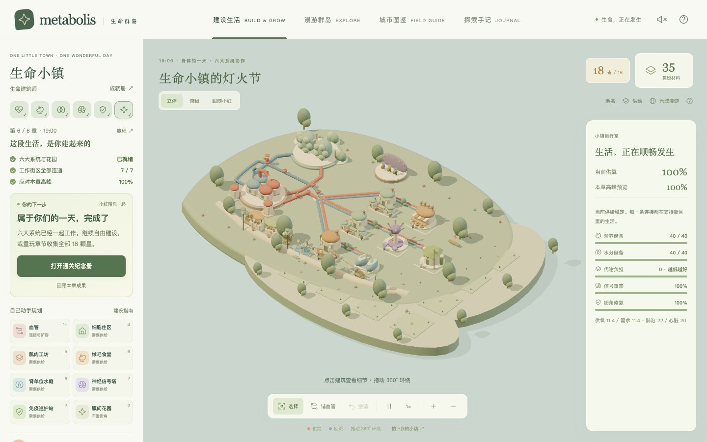
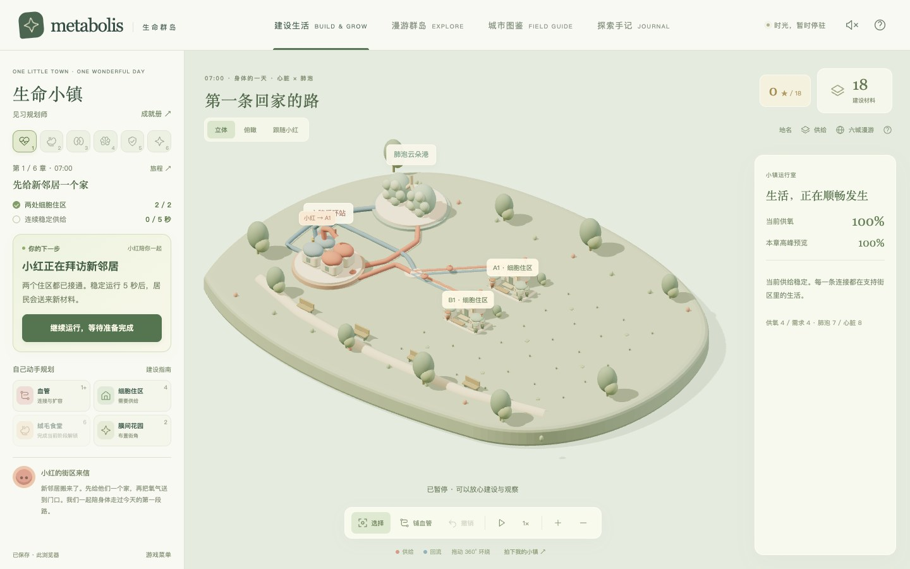
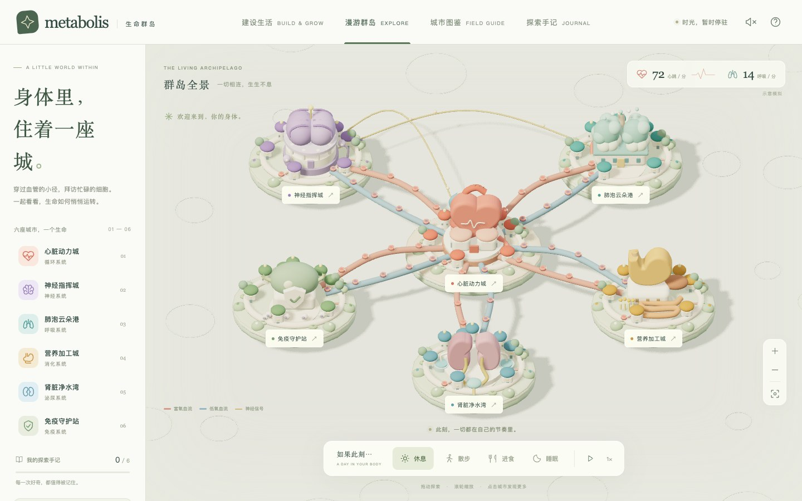
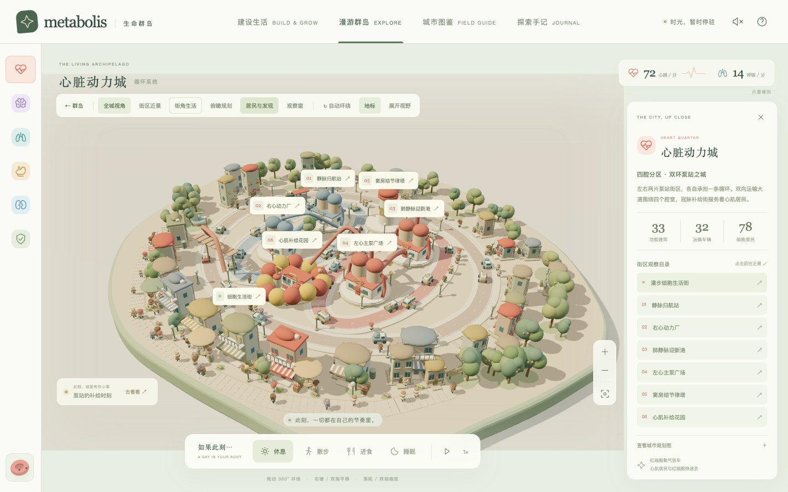
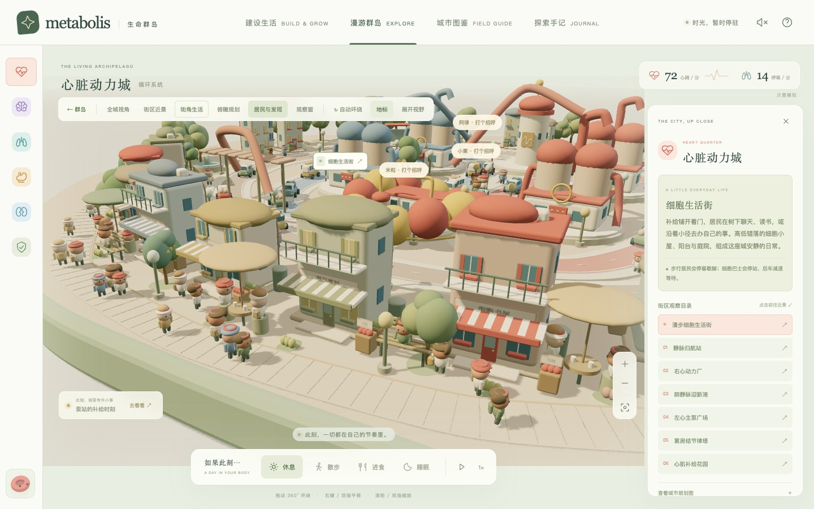
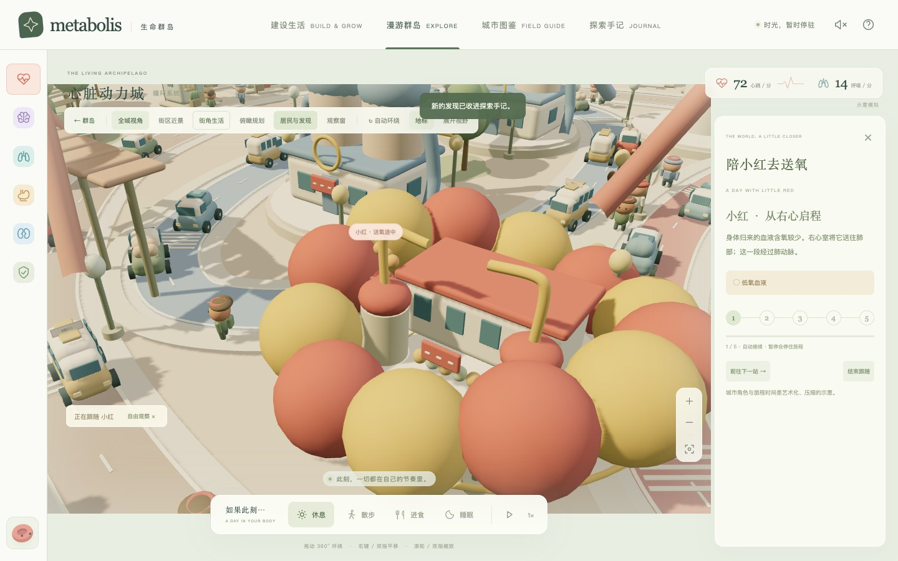
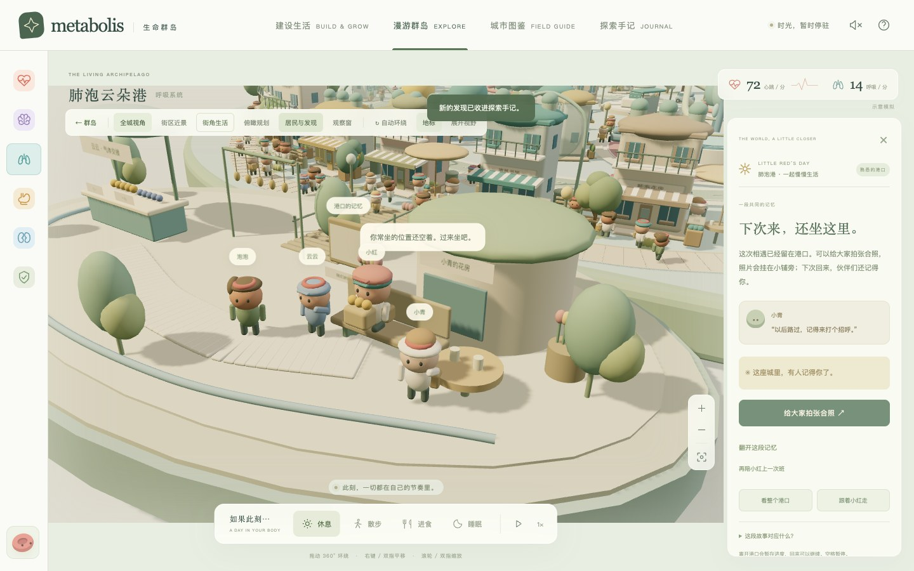

<div align="center">

# Metabolis · 生命群岛

### 身体里，住着一座城。

**建设一座有生命的小镇，走进六大人体系统，陪细胞居民度过平凡而奇妙的一天。**

A little world within — a 3D city-building and exploration game inspired by the human body.

[](https://kevin08zhao.github.io/Metabolis-Living-Cities/)
[](city/package.json)


[开始游玩](#play) · [建设玩法](#build) · [六城探索](#explore) · [港口故事](#story) · [操作与存档](#controls) · [本地运行](#local) · [开发与部署](#development)



*一座从清晨建设到灯火节的小镇。截图为游戏实机画面。*

</div>

## 这是什么游戏？

**Metabolis · 生命群岛**是一款以人体系统协作为规则的 3D 城市建设与探索游戏。你既是小镇的规划者，也是微观世界里的访客：为细胞安家、连接血管、管理供氧与资源，再走进器官化作的城市，认识居民、观察运输、收藏自己的旅途。

这里的进步由日常生活来见证。第一条回家的路、送到每条街的早餐、一段练习中的旋律，最后汇成所有街坊一起参加的灯火节。规划会带来可见的变化，居民的生活也会帮助你理解系统之间的联系。

| 体验 | 你会做什么 |
| --- | --- |
| **建设生活 · 身体的一天** | 在同一座持续成长的小镇里完成六章挑战，逐步接入六大系统，解锁结局和自由建设。 |
| **漫游群岛** | 拜访六座独立的详细城市，在地标、街区和居民生活之间自由探索。 |
| **肺泡港 · 小红的一天** | 陪红细胞小红上班、认识交接伙伴、完成气体交接，留下共同的合照。 |
| **探索手记** | 记录居民、事件、结构发现和旅程，收藏明信片与喜欢的机位。 |

**本仓库是新版浏览器游戏，全部游戏源码位于 `city/`。** 旧版项目独立保留在 [Metabolis_final](https://github.com/Kevin08Zhao/Metabolis_final)。新版采用 Three.js、TypeScript 和 Vite，不需要安装 Godot。

<a id="play"></a>

## 开始游玩

### [点击进入生命群岛 →](https://kevin08zhao.github.io/Metabolis-Living-Cities/)

直接在浏览器中游玩，无需注册、登录或配置 API 密钥。推荐使用支持 WebGL 的现代桌面浏览器，并开启硬件加速；建设界面主要面向电脑和平板。小屏幕提供响应式布局，细致规划时更推荐较大的屏幕。

初次打开会进入「建设生活」。小红会带你完成 **建设 → 连接 → 生活**：

1. 点击「和小红一起开始」，阅读左侧 **你的下一步**。
2. 给新邻居建一座细胞住区，再把血管接到家门口。
3. 让两处住区连续获得稳定供给，领取材料并开放肌肉工坊。
4. 根据供给卡的提示，调整血管容量和心肺配套，准备第一次散步。
5. 开始本章挑战，观察高峰时段的供给；需要时可以暂停改建。
6. 领取章节成果，继续迎接早餐、午后、旋律、修复与灯火节。

想先看看世界，也可以随时切换到顶部的 **漫游群岛**。建设旅程与六城探索分别记录进度。

<details>
<summary>看看新手建设界面</summary>



</details>

<a id="build"></a>

## 建设生活：把身体的一天建出来

### 一座持续成长的小镇

建设从心肺协作街区开始：初始九块土地、一处已经连通的细胞住区，以及 24 份建设材料。你会在原有布局上逐步加入消化、泌尿、神经和免疫设施，最终扩展到十六块土地。

这六章发生在**同一座小镇**中；「漫游群岛」中的六座城市则提供各个系统的详细观赏与探索场景。

| 章节 | 一起照顾的生活 | 核心机制 | 永久成果与基础奖励 |
| --- | --- | --- | --- |
| **07:00 · 第一条回家的路** | 小红与新邻居的第一次散步 | 安家、血管连接、共享容量、心肺供给 | 回家纪念树；12 份材料 |
| **09:00 · 把早餐送到每条街** | 芽芽的早餐配送 | 绒毛食堂、营养生产与储备 | 早餐小集、东岸三块新土地；14 份材料 |
| **12:30 · 留住清凉的午后** | 澄澄与炎热天气中的街坊 | 水分回收、储备与代谢负担 | 水庭喷泉；14 份材料 |
| **15:00 · 一起学一段旋律** | 闪闪带领街区练习合奏 | 神经信号覆盖、选址与工作协调 | 细胞乐台、南岸四块新土地；16 份材料 |
| **17:00 · 把小小伤口照顾好** | 团团和街角修复队 | 氧气、营养与信号共同支持修复 | 守护街灯；16 份材料 |
| **19:00 · 生命小镇的灯火节** | 所有街坊一起过节 | 综合供给、储备、覆盖、修复与花园 | 灯火、通关纪念册、自由建设；20 份材料 |

章节中的时刻用于叙事；每次生活挑战持续 **60–100 个模拟秒**，建设与观察不设统一时限。从早餐章起，中途的小安排会实际改变储备、后续需求或首次通关奖励。等待玩家选择时，挑战与资源暂停。

### 设施各有作用

| 建设项目 | 材料 | 作用 |
| --- | --- | --- |
| 细胞住区 | 4 | 给居民安家，需要持续供氧。 |
| 肌肉工坊 | 5 | 承担活动任务，生活高峰时需要更多氧气。 |
| 绒毛食堂 | 6 | 生产营养储备，为工作街区提供补给。 |
| 肾单位水庭 | 6 | 回收水分并降低代谢负担。 |
| 神经信号塔 | 7 | 协调附近工作街区，覆盖受选址、距离和自身供给影响。 |
| 免疫巡护站 | 7 | 在氧气、营养与信号支持下推进街角修复。 |
| 膜间花园 | 2 | 留出休息与生活空间，也参与部分章节目标。 |
| 血管与心肺配套 | 按类型与等级计价 | 连接街区、扩容运输，以及提升上游输送与交换能力。 |

设施会随章节逐步开放。花园属于生活布置，不增加供氧能力。

### 规划真的会影响运行

- **先连接，再供给。** 未接通的街区不会获得物流；配送员按实际计算的路线移动。
- **沿途共享容量。** 只升级心肺，无法消除下游道路上的堵点；需要一起考虑分支、路线和扩容。
- **各个系统相互支持。** 工作会消耗资源，信号塔需要合理选址，免疫修复也需要稳定补给。供给卡会解释断路、缺氧、储备不足和覆盖问题。
- **建议跟着布局变化。** 「你的下一步」会给出位置、费用与地图高亮，可以一键执行，也可以关闭引导后自己规划。
- **调整有余地。** 建筑与道路回收全额返还，迁移免费，心肺配套可逐级回收；支持撤销最近 30 次建设。开始挑战和领取阶段奖励时会重置撤销历史。

### 星级、成就与自由建设

六章最多获得 **18 颗星**，另有 **10 枚永久徽章**。每章第一颗星代表完成目标，第二颗要求至少 95% 的时间稳定运行，第三颗对应本章专属目标，如保留花园、储备充足或信号全覆盖。

结算会展示稳定运行时间、平均供氧、材料奖励与新纪念物。失败保留全部布局和材料，调整后可免费重试；也可以从菜单提前结束本轮。重玩保留最佳星级，不重复发放材料。

通关后可以继续自由建设、给小镇改名、拍照，或重玩章节收集满星与「生命建筑师」徽章。

<a id="explore"></a>

## 漫游群岛：六座城市，一个生命



| 城市 | 对应系统 | 走进去会看到什么 |
| --- | --- | --- |
| **心脏动力城** | 循环 | 四腔双环泵站、单向流动，以及连接肺与身体组织的运输路线。 |
| **神经指挥城** | 神经 | 放射状通信网络、神经元枝芽和信号传递地标。 |
| **肺泡云朵港** | 呼吸 | 树状双叶交换港、肺泡交换站，以及可以参与的港口生活。 |
| **营养加工城** | 消化 | 曲折的加工工序、小肠吸收区与肝脏分站。 |
| **肾脏净水湾** | 泌尿 | 双侧肾单位水渠、过滤、重吸收与水岸生活街。 |
| **免疫守护站** | 免疫 | 六角淋巴要塞、巡护与协作场所。 |

每座城拥有五至六处主要功能地标与外围居民街区。你可以在全城、街区近景和俯瞰视角之间切换，360° 环绕观察，也可以收起档案、隐藏标签，安静地看一会儿。

<table>
  <tr>
    <td width="50%"><br><b>器官化作城市</b><br>街道、地标与运行设备共同讲述系统的工作。</td>
    <td width="50%"><br><b>把镜头放低一点</b><br>补给铺、书屋、庭院和街边座位里，居民有自己的日常。</td>
  </tr>
  <tr>
    <td><br><b>陪小红去送氧</b><br>从右心出发，经肺、左心和大脑组织，再回到右心。</td>
    <td><br><b>在城里认识朋友</b><br>经历一次交接、一次等候，留下一段共同的记忆。</td>
  </tr>
</table>

### 不只是看风景

- **认识居民与车辆。** 每城有三位有名字的居民；点击街上的居民或车辆，可以查看状态、目的地和货物，并跟随移动。居民按照编排的日常行动，不提供自由聊天。
- **沿街生活。** 慢慢走、坐在街边、搭一班细胞慢车，看居民读书、购物、聊天和休息。车辆会停站，后车会保持间距并等待。
- **五站送氧旅程。** 镜头随小红切换城市，途中可暂停、跳到下一站或结束。完成后记录在探索手记中。
- **四种生活状态。** 切换休息、散步、进食与睡眠，观察心跳、呼吸、运输和营养活动的变化；也可以跟随三站讲解理解系统如何协作。
- **偶遇小事件。** 每城有三阶段短事件和对应视觉线索，到现场观察交接阶段可以获得发现。
- **人体观察窗。** 拖动简化的结构对照图，或用方向键移动，在地标附近阅读说明并记录发现。
- **明信片与机位。** 摄影模式隐藏界面，照片可下载，机位可回访。手记最多保留四张明信片和八个机位，超出时替换最早的一项。
- **环境声。** 主动开启声音后，可以听到轻柔心跳与具有方向、距离变化的合成街景提示音。

<a id="story"></a>

## 肺泡港 · 小红的一天

进入「肺泡云朵港」，点击 **和小红一起上班**；也可以从任一城市的「居民与发现」进入这段约三分钟的故事。

**出发 → 等候 → 认识交接伙伴 → 气体交接 → 回到街角 → 下班小聚**

泡泡负责带路，云云负责交接，小青在花房旁等大家。小红会在场景里行走、招手、排队、携带补给和坐下。交接前，你需要认出云云：点击场景中的居民或名片即可，认错会得到提示，不扣分。其余段落自动进行，也可以选择「快进这一段」。

故事与模拟共用时钟，暂停会停住动作和计时。离开港口会暂存进度，回来后从故事入口继续。完成后，居民会使用熟悉的问候，手记里会留下经历；拍下的合照会真正挂在花房旁的相框里，可再次查看和下载。

<a id="controls"></a>

## 操作与存档

### 常用操作

| 操作 | 用法 |
| --- | --- |
| 选择与建设 | 点击工具、地块、建筑或道路；也可以执行「你的下一步」。 |
| 群岛移动 | 拖动平移，滚轮或双指缩放；右侧按钮可缩放或回到全景。 |
| 城区与建设镜头 | 左键或单指拖动环绕；城区内右键或双指平移，滚轮或双指缩放。 |
| 走近地标 | 点击场景标签、地标或街区目录。 |
| 停止跟随 | 拖动镜头，恢复自由观察。 |
| 暂停与速度 | 工具栏切换暂停和 0.5× / 1× / 2×；空格可暂停，输入或按钮获得焦点时以当前控件为准。 |
| 返回 | 探索时按 Esc 返回全景，摄影时退出拍照；建设时关闭当前详情。 |
| 观察窗 | 拖动窗口或使用方向键。 |

暂停时仍可建设和调整镜头。建设模式中打开菜单、成就或结算会自动暂停，关闭后恢复原来的运行状态。

### 进度保存在当前浏览器

游戏无需服务器账户，使用浏览器本地存储自动保存。**更换浏览器、设备、访问地址，或清除网站数据后，存档不会自动跟随。** 本地开发地址和在线游玩地址也各自保存进度，目前没有云同步或存档导出功能。

| 内容 | 保存方式 |
| --- | --- |
| 建设小镇 | 每次建设、选择、里程碑、离开页面，以及每五个模拟秒保存。刷新可恢复布局、章节、资源和待选事件。 |
| 上一座小镇 | 「再建设一个新小镇」会先备份当前小镇；可用「切换到上一座小镇」在两座之间切换。 |
| 六城足迹与探索手记 | 分别保存拜访、居民、事件、旅程、观察、照片和机位。 |
| 港口工作日 | 阶段变化、离城、关闭页面，以及进行中每五秒保存；意外退出最多可能丢失最近五秒故事进度。 |
| 港口合照 | 与普通明信片独立保存，明信片列表轮替不会删除港口最近一张合照。 |

离线期间不会继续推进挑战或消耗建设资源。浏览器无法保存时，建设、照片等相关界面会给出提示。新版建设模块的 `v1` 存档会迁移到 `v2`；这里指本浏览器游戏的存档格式，不是旧版 Godot 项目的存档。

<details>
<summary>本地存储键名（排查或备份时参考）</summary>

| 键名 | 内容 |
| --- | --- |
| `metabolis.planning.v2` | 当前建设小镇 |
| `metabolis.planning.previous-city` | 上一座小镇 |
| `metabolis.explored.v1` | 六城拜访足迹 |
| `metabolis.journal.v2` | 探索手记、明信片与机位 |
| `metabolis.harbor.workday.v1` | 港口工作日、完成次数与最近合照 |

</details>

## 美术与科普表达

游戏采用程序化立体模型：奶油色的膜状小屋、圆润的器官地标、神经元枝芽、管道、树木和细胞居民组成一个温暖的微观世界。睡眠时灯光变暗，窗内透出暖光；灯火节拥有独立的晚间色调。美术与声音均可在本地运行，不依赖在线素材服务。

城市是帮助理解系统协作的艺术比喻。道路、车辆、排队、柜台和修复队伍并非真实解剖结构；容量、材料、时间和覆盖距离是游戏平衡参数。观察窗是说明性结构图，心跳等展示数值来自趋势模拟，不是个人测量数据。

游戏保留右心 → 肺 → 左心 → 组织 → 右心的基本循环关系。红蓝道路用于区分相对含氧状态，真实血液不会变蓝；肺动脉低氧、肺静脉富氧。营养运输、淋巴回流、水分回收及其他未绘制的系统经过简化。港口故事中的气体交接采用拟人化叙事，真实交换持续发生，不需要人工搬运。

游戏内 **了解这个世界** 提供 NIH 旗下 NHLBI、NIDDK、NINDS 与 NIAID 的科普资料入口，链接集中在 [`city/src/model.ts`](city/src/model.ts)。

<a id="local"></a>

## 本地运行

推荐 **Node.js 24**，最低为 **22.12.0**。仓库内 `city/.nvmrc` 指定 Node.js 24。

```bash
git clone https://github.com/Kevin08Zhao/Metabolis-Living-Cities.git
cd Metabolis-Living-Cities/city
npm ci
npm run dev
```

浏览器打开 **http://127.0.0.1:5173/**。默认仅监听本机；首次安装依赖需要网络，安装后本地游戏运行不需要在线素材或 API 服务。

macOS 用户也可以在安装 Node.js 后，双击根目录的 **启动生命群岛.command**。脚本会在首次启动时安装依赖并打开浏览器；游玩时保留终端窗口，按 `Control+C` 停止。如果文件下载后丢失执行权限，可在项目根目录运行：

```bash
chmod +x 启动生命群岛.command
```

Windows 和 Linux 用户使用上面的 `npm` 命令即可。生产构建需要通过 HTTP 服务运行，请勿直接双击 `index.html`。

<a id="development"></a>

## 开发、验证与部署

### 技术组成

| 层次 | 实现 |
| --- | --- |
| 3D 世界 | Three.js、程序化几何体、场景与相机交互 |
| 游戏与界面 | 严格模式 TypeScript、原生 DOM、CSS 响应式布局 |
| 开发与构建 | Vite；相对资源路径支持 GitHub Pages 项目子目录 |
| 音效与进度 | Web Audio、浏览器本地存储 |
| 测试 | Node.js 内置测试运行器；Playwright 可用于浏览器验证 |

### 项目结构

```text
Metabolis-Living-Cities/
├── README.md                   # 游戏介绍与项目入口
├── docs/images/                # README 实机截图
├── 启动生命群岛.command        # macOS 本地启动入口
└── city/
    ├── README.md               # 详细机制与实现说明
    ├── package.json
    ├── package-lock.json       # 固定依赖版本
    ├── public/                 # 网站图标
    ├── src/
    │   ├── main.ts             # 主界面、导航与模拟控制
    │   ├── planning*.ts        # 建设规则、供给网络、引导、场景与交互
    │   ├── campaign.ts         # 六章内容、事件选择与徽章
    │   ├── model.ts            # 六城内容、循环路线与模拟规则
    │   ├── world.ts            # 群岛与场景切换
    │   ├── city-plans.ts       # 六城街道与功能分区
    │   ├── district.ts         # 城区模型、设备动画与镜头
    │   ├── street-life.ts      # 车流、停站与居民步行
    │   ├── experience.ts       # 居民、事件、旅程与手记数据
    │   ├── explore-ui.ts       # 探索、拍照与手记交互
    │   ├── observation.ts      # 人体观察窗
    │   ├── workday*.ts         # 港口故事、进度与交互
    │   ├── harbor.ts           # 港口场景与角色动作
    │   ├── soundscape.ts       # 合成街景音效
    │   └── *.css              # 建设、探索与响应式样式
    ├── tests/                  # 规则、旅程、街景和故事回归测试
    ├── scripts/deploy-pages.mjs
    └── vite.config.ts
```

### 常用命令

以下命令在 `city/` 中执行：

```bash
npm test          # 游戏逻辑回归测试
npm run build     # TypeScript 检查 + 生产构建，输出到 dist/
npm run preview   # 预览生产构建，默认 http://127.0.0.1:4173/
```

当前版本包含 **50 项自动化测试**，覆盖六章完整通关、18 星与最终徽章、选择暂停与恢复、供给容量与守恒、失败后重试、奖励防重复、存档迁移、循环路线、车辆停站、居民节奏和港口故事。逻辑测试之外，发布时也检查浏览器中的建设入口、城市切换与故事交互。

### GitHub Pages 发布

在线版由本仓库的 `gh-pages` 分支提供。源码保存在 `main`；生成的 `dist/` 和 `node_modules/` 不提交到源码分支。

维护者提交源码后，在 `city/` 运行：

```bash
npm run deploy
```

脚本会先运行测试和生产构建，再将静态文件提交到远程仓库的 `gh-pages` 分支。需要本机 Git 已登录、配置提交身份，并拥有新版仓库的推送权限。首次设置时，在 GitHub **Settings → Pages** 选择 **Deploy from a branch → gh-pages → / (root)**。后续源码提交不会自行更新网页，运行部署命令后才会发布新构建。

## 反馈与参与

欢迎通过 [Issues](https://github.com/Kevin08Zhao/Metabolis-Living-Cities/issues) 提交问题或玩法建议。报告运行问题时，请附上浏览器、设备、出现问题的章节或城市，以及复现步骤；涉及存档的问题请先保留现场。

目前仓库尚未指定开源许可证。公开源码不等同于授予任意使用、再分发或商业使用许可；如需这些授权，请先联系维护者。依赖库遵循各自许可证。

<div align="center">

**每一条路，都通向一段生活。**

[进入生命群岛](https://kevin08zhao.github.io/Metabolis-Living-Cities/) · [查看旧版项目](https://github.com/Kevin08Zhao/Metabolis_final)

</div>
